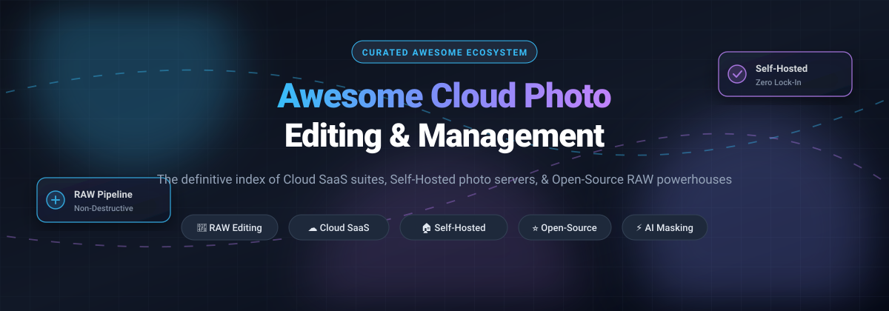

# 📸 Awesome Cloud Photo Editing & Management 🌟

**The curated directory of cloud photo editing suites, self-hosted photo servers, and open-source RAW development powerhouses.**

*Optimized for non-destructive RAW editing, high-scale library management, self-hosting privacy, and automated photography workflows.*

[Explore SaaS](#-saashosted-platforms) • [Open Source Options](#-open-source-github-projects) • [Contributing](#-how-to-contribute) • [Support](#-support)

---

## 📖 Overview & SEO Summary

Looking for the best **cloud photo editing software**, **self-hosted Google Photos / Lightroom alternatives**, or **open-source non-destructive RAW converters**? 

Managing and developing massive libraries of digital photography presents steep challenges: balancing expensive cloud subscription lock-in against the freedom of local, private storage. This repository maintains an up-to-date, comprehensive overview of both top-tier **commercial SaaS ecosystems** (Adobe Lightroom, Capture One, DxO, Skylum) and battle-tested **open-source & self-hosted platforms** (Immich, PhotoPrism, Ente, darktable, RawTherapee, digiKam).

Whether you need cloud sync across desktop and mobile, AI-powered face detection and geotagging, or a zero-subscription pipeline running on Docker, find the exact tool tailored to your workflow below.

---

## 📑 Table of Contents

- [📊 Sector Overview & Market Dynamics](#-sector-overview--market-dynamics)
- [☁️ SaaS/Hosted Platforms](#-saashosted-platforms)
- [💻 Open-Source GitHub Projects](#-open-source-github-projects)
- [🤝 How to Contribute](#-how-to-contribute)
- [⚠️ Disclaimer](#️-disclaimer)
- [⭐ Star History](#-star-history)
- [💖 Support](#-support)

---

## 📊 Sector Overview & Market Dynamics

The global photo editing and management software market is estimated at approximately **$1.5B – $3B+**, expanding at an 8%–10% CAGR toward broader digital creation ecosystems. The industry exhibits a dual structure: heavily **concentrated at the professional desktop/workflow tier**—where Adobe exercises dominant market power alongside specialized challengers—while remaining **moderately to highly fragmented at the consumer and mobile periphery**, where casual web utilities, mobile filter apps, and open-source alternatives continuously compete for user attention.

---

## ☁️ SaaS/Hosted Platforms

A comparative overview of industry-leading commercial photography platforms, ranked by corporate scale and valuation:

| Product | Company Scale (Revenue / Valuation) | Pricing | Free Tier Limit | Description |
| :--- | :--- | :--- | :--- | :--- |
| **[Adobe Lightroom](https://www.adobe.com/lightroom)** | **$21B+ Revenue** / ~$130B–$200B+ Market Cap (Adobe Inc., Public: ADBE) | **$14.99/month** (annual billed monthly) or **$149.99/year** prepaid (Lightroom 1TB plan) | **7-day free trial** (full access with 1TB cloud storage; no permanent free tier) | Cloud-first photo editing and management with 1TB storage. |
| **[Corel AfterShot Pro 3](https://store.aftershotpro.com/)** | **~$100M+ Revenue** / $1B+ Valuation (Alludo / KKR) | **$79.99** one-time purchase | **30-day free trial** (unrestricted full access to batch RAW workflows; no permanent free tier) | Fast RAW editor with Linux support. |
| **[Capture One Pro](https://www.captureone.com/)** | **~$28M–$35M Revenue** (Private, Axcel) | **$24.00/month** (billed monthly), **$299.00/year**, or **$299.00** perpetual license | **30-day free trial** (unrestricted pro features and tethering; no permanent free tier) | Professional RAW editor with tethering and color grading tools. |
| **[Skylum Luminar Neo](https://skylum.com/)** | **~$18M–$20M Revenue** (Private) | **$11.95/month**, **$79.00/year**, or **$199.00** perpetual desktop license | **7-day free trial** (full access to generative and AI editing tools; no permanent free tier) | AI-focused editor with sky replacement, relighting, and generative tools. |
| **[DxO PhotoLab 10](https://www.dxo.com/)** | **~$12M–$18M Revenue** (Private, VC/PE backed) | **$249.99** one-time new license (**$129.99** upgrade from PhotoLab 8/9) | **30-day free trial** (fully functional with no watermark and no credit card required; no permanent free tier) | One-time-purchase RAW editor with AI masking and optical corrections. |
| **[ON1 Photo RAW 2027](https://www.on1.com/)** | **~$3M–$5M Revenue** (Private) | **$99.99** one-time perpetual license or **$89.99/year** subscription (MAX edition) | **30-day free trial** (complete uninhibited access to all AI tools, layers, and masking; no permanent free tier) | All-in-one editor available as perpetual or subscription. |

---

## 💻 Open-Source GitHub Projects

Explore the finest self-hosted galleries, cloud photo managers, and open-source RAW development engines, sorted by GitHub stargazers count:

| Project | Stars | Focus & License | Highlights |
| :--- | :--- | :--- | :--- |
| **[Immich](https://github.com/immich-app/immich)** |  | Self-Hosted Cloud Photo & Video Backup (AGPL-3.0) | High-performance self-hosted backup solution directly rivaling Google Photos and Apple Photos. Includes native iOS/Android mobile apps, automated backup, facial recognition, vector search, and multi-user management. |
| **[PhotoPrism](https://github.com/photoprism/photoprism)** |  | AI-Powered Photo Management (AGPL-3.0) | Web-based personal photo management driven by Go and Google TensorFlow. Features automatic classification, facial recognition, RAW image conversion, duplicate detection, and interactive world map views. |
| **[Ente Photos](https://github.com/ente-io/ente)** |  | End-to-End Encrypted Cloud Photo Storage (AGPL-3.0) | Complete open-source, end-to-end encrypted (E2EE) photo storage ecosystem with native clients across iOS, Android, web, and desktop. Ideal for privacy-focused automated cloud synchronization. |
| **[darktable](https://github.com/darktable-org/darktable)** |  | Non-Destructive RAW Developer & Lighttable (GPL-3.0) | The primary open-source Adobe Lightroom alternative. Features an advanced 32-bit floating-point scene-referred color pipeline, parametric and drawn masking, tethered camera capture, and high-volume catalog management. |
| **[LibrePhotos](https://github.com/LibrePhotos/librephotos)** |  | Self-Hosted Open-Source Photo Server (GPL-3.0) | Community-driven self-hosted photo management service (formerly Ownphotos). Offers face recognition, semantic image search, object detection, reverse geocoding, and Nextcloud integration. |
| **[GIMP](https://github.com/GNOME/gimp)** |  | Raster Graphics & Retouching Editor (GPL-3.0) | The definitive open-source image manipulation program. Provides pixel-level retouching, compositing, layer blending, and extensible scripting to polish exported RAW photos. |
| **[RawTherapee](https://github.com/RawTherapee/RawTherapee)** |  | High-Fidelity RAW Converter & Processor (GPL-3.0) | Renowned for exceptional demosaicing algorithms (AMaZE, RCD, DCB), advanced wavelet controls, and high-bit-depth rendering. Tailored for pixel-level color grading and maximum optical detail extraction. |
| **[digiKam](https://github.com/KDE/digikam)** |  | Professional Photo Management & Cataloging (GPL-2.0) | Advanced open-source digital asset management (DAM) application. Excels at organizing libraries with tens of thousands of images, hierarchical tagging, facial recognition, geolocation, and EXIF/IPTC metadata curation. |
| **[ART (Another RawTherapee)](https://github.com/artraweditor/ART)** |  | Streamlined RAW Processing Pipeline (GPL-3.0) | Refined fork of RawTherapee delivering its state-of-the-art demosaicing engine through an intuitive, streamlined user interface with simplified masking and fast workflow presets. |

---

## 🤝 How to Contribute

Contributions are warmly welcomed! Help keep this guide the premier hub for photographers and developers alike:

1. 🍴 **Fork the repository** to your own GitHub profile.
2. 🌿 **Create a descriptive feature branch** (`git checkout -b add-innovative-photo-tool`).
3. 📝 **Add or update entries** following existing conventions:
   - Ensure products include verifiable pricing and trial parameters.
   - For open-source tools, include the repository URL, focus, and licensing.
4. 🚀 **Commit your updates** with a clear commit message.
5. 📬 **Submit a Pull Request** with a brief summary of the proposed additions.

---

## ⚠️ Disclaimer

- This is an **independent, community-curated list** — inclusion does not imply official endorsement or sponsorship.
- **Workflow Pairing**: While commercial platforms like Lightroom combine editing and cataloging under one roof, open-source setups frequently thrive when paired together (e.g., **digiKam** or **Immich** for indexing, alongside **darktable** or **RawTherapee** for RAW processing).
- **AI Feature Gaps**: High-end proprietary AI neural masking (e.g., Lightroom's one-click sky and subject selection) remains proprietary, though open-source self-hosted solutions (Immich, PhotoPrism) lead in local AI categorization and facial recognition without privacy trade-offs.

---

## ⭐ Star History

---

## 💖 Support

Thank you for exploring and utilizing **Awesome Cloud Photo Editing & Management**! 🙏

If this resource has helped streamline your photography workflow, save on subscription fees, or discover incredible open-source tools, please consider showing your support:

- ⭐ **Star this repository** to improve visibility for the photography community.
- 🍴 **Fork and share** with fellow creators, photographers, and self-hosters.
- ☕ **Sponsor or buy a coffee** to fuel continued updates and open-source curation:
  
  

---

  Maintained with ❤️ by <a href="https://github.com/ishandutta2007">Ishan Dutta</a> and the global open-source photography community.

